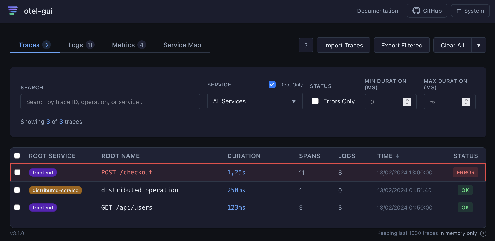
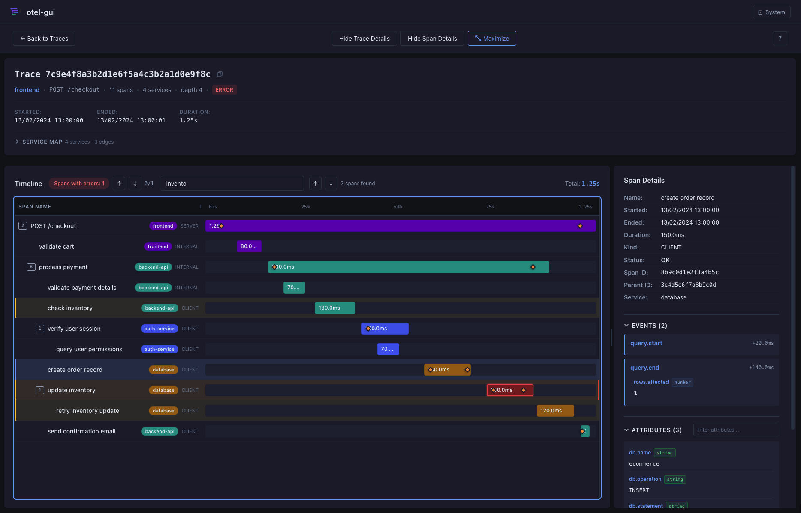
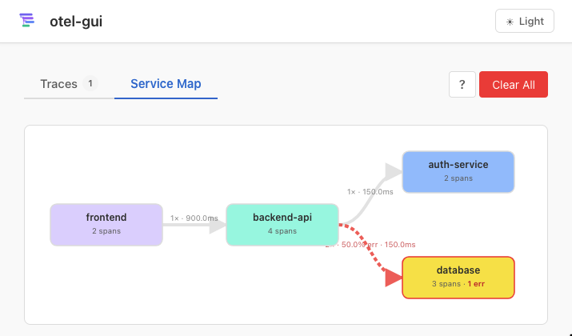
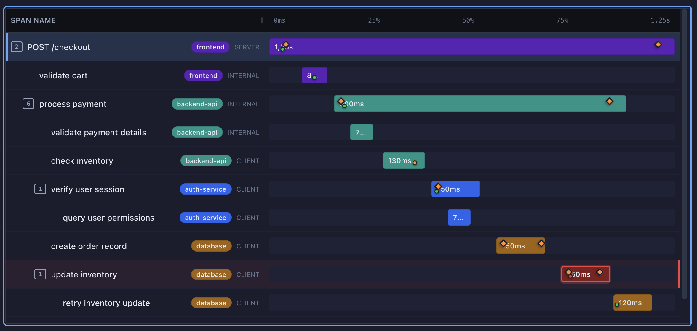
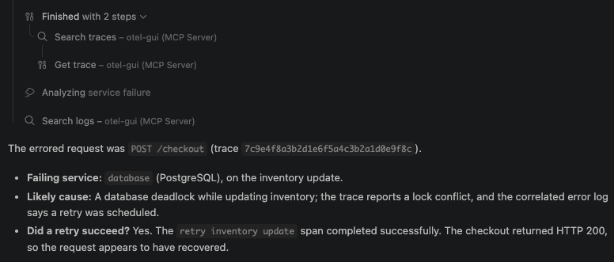
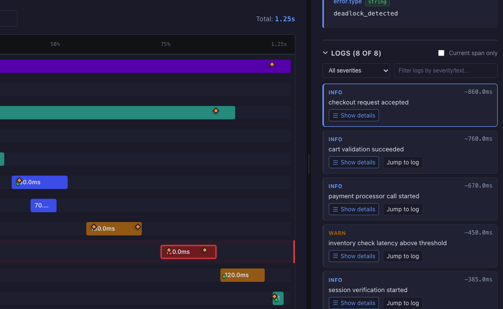

# Developing a local OpenTelemetry viewer for developers and AI agents alike

OpenTelemetry makes it possible to collect traces, logs, and metrics from an application without tying your instrumentation to a particular observability vendor. But when you are developing locally and something goes wrong, there is still a practical question:

**How do you quickly see what your application just sent?**

During development, it is crucial to validate the telemetry being generated by your application. You should ensure that traces look as expected, that events and logs are correctly generated, and that attributes and events are correctly set.

I started building [otel-gui](https://github.com/metafab/otel-gui) to make that step easier: point an OpenTelemetry exporter at a local viewer, execute a request or reproduce a problem, and explore the telemetry without first setting up a full observability stack.

The goal has since grown. The same local telemetry should be easy for a developer to understand visually **and** accessible to an AI agent through tools and APIs, without asking the agent to operate the UI, which would be suboptimal.

## Why build another OpenTelemetry viewer?

There was already a viewer recommended at work for the local setup, but I did not find it user-friendly or visual enough for the way I wanted to investigate telemetry. I wanted to get from “something is slow” or "something is broken" to a clear picture of the request flow with less friction, minimal setup and key features we can find in full hosted observability products such as Honeycomb, Datadog, or New Relic.

That is what shaped the first version of otel-gui: a local-first debugging tool, not another hosted observability platform. It listens by default on port `4318`, the standard OTLP/HTTP port, so many applications can send telemetry to it with little or no exporter reconfiguration. It accepts OTLP JSON and Protobuf, and it does not require a database to get started.

## From traces to traces, logs, and metrics



The initial focus was **traces**. The project began as a lightweight OTel trace viewer that groups spans in a waterfall view to show their parent-child relationships and timing. This makes it easier to see the flow of a request. It also makes it easy to find errors and inspect what happened at each step with the context represented as attributes and events.<br>
The tool also provided a **service map** to make cross-service calls easier to see. How services such as frontend, backend, and database interact and where bottlenecks occur becomes more apparent with this visual representation.

Soon after, the project added **correlated logs** to enrich spans with related log entries. This made it easier to understand the context around each span and to trace the sequence of events leading up to an error or performance issue.

**Global logs** came next with version 2.0. More recently, **metrics** joined the picture in version 3.0, with charts and views for different OTLP metric types. The three signals of telemetry—traces, logs, and metrics—are now all represented, making it easier to get a complete picture of what is happening in your application. The aim stayed the same: focus on making local telemetry useful quickly.

One useful design choice was to keep the default setup small. By default, telemetry is retained in memory; you can run the viewer locally and start exploring without provisioning a database. Optional persistence is available for setups that need it, but it is not a prerequisite for the basic workflow.

## Export/Import to share telemetry

otel-gui also supports **exporting and importing telemetry data**, making it easier to share traces and logs with others. This can be useful for collaboration, debugging, or reproducing issues in different environments. Picture you capturing a complex trace locally and then sharing it with a teammate for further investigation without needing access to the original system. You can even attach it to a bug report or a support ticket for context.

Export telemetry from the UI to save the data to a file, then import it back into otel-gui. This allows you to save and transfer telemetry for later analysis or share it with team members without requiring access to the original data sources.

The export/import feature complements the local-first approach by enabling controlled sharing of telemetry while keeping the primary data local and disposable.

Today, otel-gui accepts OTLP traces, logs, and metrics over HTTP, provides an easy-to-use browser UI, and a way to export and import telemetry data for sharing and collaboration. Since version 3.1, it also includes an **MCP server** and **HTTP endpoints** for scripts and agents.

## Why a visual interface still matters

Telemetry is structured data, but debugging is often a process of forming and testing hypotheses. A visual trace view helps answer questions that can be awkward to piece together:

- Which service handled this request?
- Where did the time go?
- Which span failed, and what happened immediately before it?
- Did a retry succeed?
- Are there logs correlated with the failing span?

The waterfall makes timing and parent-child relationships visible. The span details panel brings attributes, events, resource information, and correlated logs together. The service map gives a broader view of how services relate.

That makes the UI a good place for a person to explore, spot patterns, and decide what to investigate next.



_A trace is easier to reason about when its timing, hierarchy, and details are visible together._



_The service map helps orient an investigation across service boundaries._

That's great for human users, but what about AI agents?

## AI agents need a different interface

An AI agent should not have to click through a browser UI or interpret a screenshot to inspect telemetry. It needs a direct, bounded way to ask questions and retrieve relevant records.

otel-gui provides a read-only [Model Context Protocol (MCP)](https://modelcontextprotocol.io/) endpoint with tools for searching traces, logs, and metrics; fetching individual records; listing services; and viewing the service map. An MCP-compatible agent can use those tools as part of a debugging conversation.

An HTTP API complements the MCP interface, giving agents an alternative way to query and retrieve telemetry data programmatically if MCP is not available or suitable for them. This HTTP API is also intended for scripts that make ordinary HTTP requests.

The project publishes an [`llms.txt`](https://github.com/metafab/otel-gui/blob/main/static/llms.txt) index pointing to the API guide and OpenAPI specification, so a client can discover how to read telemetry without guessing endpoint shapes.

The two interfaces–visual or programmatic–serve different users, but they expose the same local telemetry: a person can inspect a waterfall, while an agent can search for an error and fetch the matching trace.

## A debugging example: the failed checkout

The repository includes an e-commerce demo that sends a multi-service checkout trace, correlated logs, and metrics. Its sample scenario includes a database deadlock during an inventory update followed by a retry.

Here is what it looks like for a human after running the demo:



Here is an example of the kind of request you could give an MCP-connected agent:

> Use otel-gui to investigate the failed checkout. Find the request with an error, then summarize the failing service, the likely cause, and whether a retry succeeded.

An agent might produce a summary like this:



This is an illustrative example based on the bundled sample scenario, but it is representative of what an agent might report in a real investigation. An agent can investigate and report what actually happened in the telemetry, not turn a plausible explanation into an unsupported claim.

The sample can be sent to a running instance with `./demo-ecommerce.sh`. MCP is available at `http://localhost:4318/mcp` by default; see the [setup instructions](https://github.com/metafab/otel-gui#connect-an-ai-agent-with-mcp) for connecting an agent.



_Correlated logs give an agent—or a developer—more context around a span._

## Local-first also means thinking about access

Keeping telemetry local can make experimentation simpler, but it does not make telemetry non-sensitive. otel-gui's HTTP API does not authenticate clients. MCP is read-only and restricted to loopback clients by default, but deployments should still be protected at the network boundary. Avoid exposing a local instance to untrusted networks.

This is a development viewer with bounded local retention, not a replacement for production observability, access control, or long-term telemetry storage.

## Try it with your own application

[Getting started](https://github.com/metafab/otel-gui#%EF%B8%8F-quick-start) is easy. otel-gui comes as self-contained executables for Linux, macOS, and Windows. Homebrew, Docker and Nix are also supported, and the full source code is available on [GitHub](https://github.com/metafab/otel-gui).

Start otel-gui, then point an OTLP/HTTP exporter at the local endpoint:

```sh
export OTEL_EXPORTER_OTLP_ENDPOINT=http://localhost:4318
```

Open [http://localhost:4318](http://localhost:4318), reproduce a request, and explore the traces, logs, and metrics your application emits. To see a sample flow without instrumenting an application first, run:

```sh
./demo-ecommerce.sh
```

If you want an agent to investigate the same telemetry, connect it to the local MCP endpoint and ask it to search and explain—while keeping its access read-only.

The broader idea behind otel-gui is simple: **local telemetry should be easy to understand, whether the person investigating it is a developer looking at a trace or an AI agent querying it through a tool**. I am continuing to build toward that shared debugging workflow.

🙏 If you try it, I would love to hear what helps you understand a trace faster—and what is still missing.

---

PS: The value of a telemetry tool like otel-gui lies in making local telemetry easy to understand and act on. For developers and AI agents to investigate issues effectively, they need rich telemetry data. Instrument your application thoroughly to capture all relevant events, errors, and performance metrics. This data is essential for reconstructing and analyzing system behavior.
