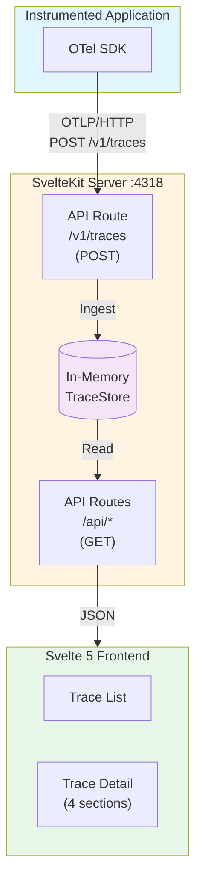

# Implementation Plan: otel-gui

A lightweight, local OpenTelemetry trace viewer inspired by Honeycomb's trace detail UI.
`otel-gui` is a **local-first debugging tool** for OpenTelemetry during development.
It optimizes the shortest path from "app emits telemetry" to "developer understands the issue" on localhost.

## Tech Stack

| Layer          | Choice                             | Rationale                                                                                     |
| -------------- | ---------------------------------- | --------------------------------------------------------------------------------------------- |
| Framework      | SvelteKit 5 (Svelte 5 runes)       | User preference. Full-stack TypeScript. Fast, lightweight.                                    |
| Adapter        | `@sveltejs/adapter-node`           | Required for persistent in-memory state and SSE support.                                      |
| Language       | TypeScript                         | Full-stack type safety.                                                                       |
| Storage        | In-memory (`Map`) behind interface | Simplest for v1. Swappable to SQLite via same interface.                                      |
| OTLP format    | JSON and Protobuf                  | Both `application/json` and `application/x-protobuf` supported.                               |
| OTLP transport | HTTP (`:4318`) + gRPC (`:4317`)    | HTTP remains the primary path; a dependency-free gRPC receiver covers gRPC-default exporters. |
| Real-time      | SSE (`EventSource`)                | Single persistent connection, instant push on ingest.                                         |
| Port           | 4318                               | Standard OTLP/HTTP port — zero config on exporter side.                                       |
| Visualization  | Custom HTML/CSS waterfall          | Industry standard approach (Honeycomb, Jaeger all do this).                                   |

## Executable Packaging Strategy

`otel-gui` OSS executable distribution uses Node 22 SEA (Single Executable Applications).

- `pnpm run sea:bundle`: generate `dist/sea-launcher.cjs`
- `pnpm run sea:package:binary`: generate SEA binary for current OS/arch
- `pnpm run sea:package`: run both steps

Distribution unit per platform:

- `otel-gui[.exe]`
- `build/` (SvelteKit adapter-node output)
- `proto/` (protobuf definitions loaded at runtime)

These three items must be shipped together.

Container images are published to GHCR by CI. The optional
[Docker Hub mirroring workflow](../.github/workflows/mirror-image-dockerhub.yml)
runs after a successful image publish (or manually) when the
`DOCKERHUB_USERNAME`, `DOCKERHUB_TOKEN`, and `DOCKERHUB_REPOSITORY` repository
secrets are configured.

## Architecture



## File Structure

```
src/
├── lib/
│   ├── types.ts                          # TypeScript types (StoredSpan, StoredTrace, etc.)
│   ├── server/
│   │   ├── traceStore.ts                 # In-memory TraceStore (server-only)
│   │   └── protobuf.ts                   # Protobuf decoder for OTLP traces
│   ├── utils/
│   │   ├── attributes.ts                 # flattenAttributes(), extractAnyValue()
│   │   ├── time.ts                       # formatDuration(), formatTimestamp()
│   │   ├── spans.ts                      # spanKindLabel(), statusLabel(), buildSpanTree()
│   │   └── colors.ts                     # Service name → color palette
│   ├── stores/
│   │   └── traces.svelte.ts              # Client-side reactive store (SSE)
│   └── components/
│       ├── TraceIdentification.svelte    # Section 1: top bar
│       ├── TraceSummary.svelte           # Section 2: collapsible minimap
│       ├── TraceWaterfall.svelte         # Section 3: waterfall container
│       ├── WaterfallRow.svelte           # Individual span row in waterfall
│       └── SpanSidebar.svelte            # Section 4: span detail sidebar
├── routes/
│   ├── +page.svelte                      # Trace list page
│   ├── +layout.svelte                    # App layout
│   ├── v1/
│   │   └── traces/
│   │       └── +server.ts                # OTLP receiver endpoint
│   ├── api/
│   │   └── traces/
│   │       ├── +server.ts                # GET /api/traces (list), DELETE (clear)
│   │       ├── stream/
│   │       │   └── +server.ts            # GET /api/traces/stream (SSE)
│   │       └── [traceId]/
│   │           └── +server.ts            # GET /api/traces/:id (detail)
│   └── traces/
│       └── [traceId]/
│           ├── +page.ts                  # Load function
│           └── +page.svelte              # Trace detail page
└── app.html
```

## v2 Product Contract & Guardrails

v2 focuses on **traces + lightweight correlated logs** for fast local debugging, not on becoming a full observability platform.

### Scope

- **Primary scope**: traces + lightweight, trace-correlated logs for local debugging and root-cause analysis
- **Deployment model**: single local process, no required external backend
- **Default behavior**: ephemeral in-memory state
- **State option**: optional local persistence mode (opt-in only)
- **Design principle**: fast startup, low friction, minimal setup

### Explicit Non-Goals

- Not a full observability suite (no enterprise dashboards/alerting/policy engine)
- Not a production-scale telemetry backend or long-term retention system
- Not a managed cloud competitor to Honeycomb/Datadog/New Relic/Grafana Cloud/Sematext
- Not a "collect everything forever" platform (bounded local storage remains required)
- Not replacing existing collector/backends in production environments

### Success Metrics

These metrics are the acceptance criteria for v2 usability and performance.

| Metric             | Definition                                                                                                      | v2 Target          |
| ------------------ | --------------------------------------------------------------------------------------------------------------- | ------------------ |
| Time to root cause | Median time from first trace appearance in UI to identifying likely failing span/service (local debugging task) | **≤ 5 min (p50)**  |
| Setup time         | Time from fresh clone to receiving first trace in UI (`pnpm install && pnpm dev` + standard OTLP endpoint)      | **≤ 10 min**       |
| Memory footprint   | Server RSS (Resident Set Size) while handling the max in-memory window (1,000 traces) in normal interactive use | **≤ 300 MB (p95)** |
| Startup latency    | Time from running `pnpm dev` to OTLP endpoint and UI being usable on localhost                                  | **≤ 5 s (p95)**    |

### Metric Measurement Guardrails

- Use a documented local benchmark script and repeatable fixture set.
- Publish machine profile (CPU/RAM/OS/Node version) with each benchmark run.
- Track trends across releases; regressions beyond 10% require explicit sign-off.

#### Validate the v2 product targets

The v2 setup, startup, memory, and time-to-root-cause targets above have not yet
been measured. Record actual measurements using the process in
[`testing.md`](./testing.md); `scripts/benchmark-contract.mjs` is currently a
scaffold, not an implemented measurement harness.

### Metrics Support Follow-up

Metrics ingestion and the list/detail views, all five OTLP metric types,
server-side Sum rates, and streaming are implemented. This section tracks the
remaining work against the current implementation.

#### Bound attribute-series cardinality

`OTEL_GUI_MAX_METRICS` caps distinct `(service.name, metric name)` entries. Each
entry can contain multiple attribute series, so this setting does not bound the
number of series held in memory. `OTEL_GUI_MAX_METRIC_POINTS` independently caps
points retained per series.

- Decide on an explicit series-retention policy and whether its limit is global or
  per metric.
- Implement the bound and expose any new configuration in `/api/config` and the
  environment documentation.
- Add tests for the chosen eviction behavior and ensure list/detail SSE remains
  consistent when series are removed.

#### Make histogram series selectable

Histogram and exponential-histogram detail views currently display only the first
series. Add series selection and attribute filtering for these views, consistent
with the line-chart experience, and clearly indicate which series is displayed.
Cover selection, filtering, and live updates in component tests.

#### Optional: persistence and exemplar links

Pursue these only when there is a concrete requirement.

- **Persistence:** Metrics currently use the in-memory store. Extend the external
  backend registered through `OTEL_GUI_PERSISTENCE_BACKEND_MODULE` to store and
  restore metric entries, attribute series, and typed points. Keep retention
  consistent with `maxMetrics` and `maxMetricPoints`, and verify restart
  restoration and eviction behavior in the backend's tests. Metrics
  import/export parity can be considered if users need it; it is not a
  prerequisite otherwise.
- **Exemplar-to-trace links:** Metric data points do not currently retain or
  display exemplars. If implemented, preserve exemplar trace/span IDs during
  ingestion, display them on the relevant chart, and link to the matching trace
  (and span when available). Check that the referenced trace is still present;
  show an unlinked marker if it was evicted or deleted. Test ingestion, rendering,
  and navigation for present and absent traces.
- **Downsampling:** Defer unless retained point counts make charts or memory use
  problematic.

## OTLP/gRPC Positioning

### Current Decision

- Keep OTLP/HTTP (`/v1/*` on `:4318`) as the primary ingestion path and the UI/API port.
- Serve OTLP/gRPC (`:4317`) as an additive receiver so exporters that default to gRPC work without reconfiguration.
- Keep the gRPC transport isolated in `src/lib/server/grpc.ts`: a cleartext HTTP/2 server built on `node:http2` (no gRPC library), reusing the protobuf decoders and `traceStore` ingestion. Store, API, and UI are unchanged.
- Enabled by default; `OTEL_GUI_GRPC_ENABLED=false` disables it and `OTEL_GUI_GRPC_PORT` moves it. A port conflict logs a warning and never prevents the HTTP server from starting.

### Scope and limits

- Unary `Export` for `TraceService`, `LogsService`, and `MetricsService`; `identity` and `gzip` message encodings.
- Plaintext only (no TLS), matching the local-first OTLP/HTTP setup.
- Partial-success responses are not emitted: a request is either fully ingested or rejected with a gRPC status.

## Maybe Later

### Trace Summary Minimap

The trace detail view does not yet include the planned span-depth minimap.
If implemented, add a collapsible horizontal chart with up to six depth rows,
bars sized by span duration, error highlighting, and click-to-scroll navigation
to the corresponding span in the waterfall. See the trace-detail research in
[`research.md`](./research.md).

## Key Design Decisions

1. **JSON and Protobuf OTLP support**: Both `application/json` and `application/x-protobuf` formats are supported using `protobufjs` with vendored `.proto` files from the OpenTelemetry specification. Byte fields (traceId, spanId) are automatically converted from base64 to hex to match OTLP JSON format.

2. **SSE over polling**: `EventSource` provides instant push on ingest with zero client-side interval management. The server endpoint debounces rapid batched exports (100 ms), sends a heartbeat every 30 s to keep proxies alive, and uses `traceStore.subscribe()` for decoupled notification. The `EventSource` API auto-reconnects on drop.

3. **Custom waterfall over charting library**: No suitable off-the-shelf Svelte trace/gantt component exists. All serious trace viewers build custom waterfalls with CSS-positioned divs.

4. **Port 4318**: Standard OTLP/HTTP port means instrumented apps can point at the viewer with zero config change — just set `OTEL_EXPORTER_OTLP_ENDPOINT=http://localhost:4318`.

5. **`$state.raw` for trace lists**: Svelte 5's `$state()` deeply proxies objects, which is expensive for large arrays of spans that are replaced wholesale. `$state.raw()` avoids this overhead.

6. **Honeycomb's 4-section layout from day 1**: Even for a simple v1, structuring the detail view into identification / summary / waterfall / sidebar gives a clean, extensible foundation. Some sections (like the summary minimap) can start simple and grow richer.

7. **`service.name` as default color dimension**: Honeycomb defaults to this too. It's the most useful visual cue in multi-service traces.

8. **Store interface for swappable storage**: The `TraceStore` interface allows dropping in SQLite later without touching API routes or frontend code.

9. **Keyboard shortcuts follow web conventions**: `/` to focus search (GitHub/YouTube pattern), `n`/`Shift+N` for next/previous match (browser devtools pattern), `e`/`Shift+E` for error navigation, `Esc` for contextual dismiss/back, `Alt/⌥+Delete` for destructive clear (no browser conflicts, hard to hit accidentally), `?` for help overlay. All shortcuts guard against firing when focus is inside an input. The `?` overlay uses the same modal pattern as the attribute fullscreen viewer.

10. **gRPC is additive, not a replacement**: OTLP/gRPC (`:4317`) is served by a small `node:http2` receiver alongside OTLP/HTTP, so gRPC-default exporters work with zero config while HTTP stays the canonical path and the store/API/UI stay transport-agnostic.
